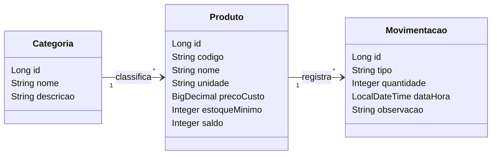

# Loja de Informática

| | |
|---|---|
| **Aluno(a)** | Leonardo Teodoro da Silva |
| **Turma** | TEC-N-001788/2026 |
| **Opção escolhida** | Controle de Estoque |
| **Versão atual** | 0.1.0 |

---

## 1. Visão geral

### 1.1 Problema
<!-- Que problema o sistema resolve? Quem sofre com esse problema hoje e como ele é resolvido (planilha, papel, WhatsApp...)? 3 a 5 linhas. --> Uma loja de informática precisa controlar os produtos disponíveis em estoque. Quando esse controle é feito manualmente, podem ocorrer erros nas quantidades e dificuldades para identificar produtos que precisam ser comprados.
O sistema tem como objetivo facilitar o cadastro dos produtos e o controle das entradas e saídas do estoque.


### 1.2 Canvas do projeto

| Bloco | Resposta |
|---|---|
| **Usuários** (quem usa o sistema) | Funcionários responsáveis pelo estoque e gerente da loja. |
| **Problema** (dor atual) | Dificuldade para controlar as quantidades dos produtos e identificar quando é necessário repor o estoque. |
| **Proposta de valor** (o que melhora com o sistema) | Facilitar a organização dos produtos e diminuir erros no controle do estoque. |
| **Funcionalidades principais** | Cadastrar produtos e categorias, consultar produtos e registrar entradas e saídas. |
| **Informações que o sistema guarda** | Nome, descrição, categoria, preço, quantidade disponível e estoque mínimo dos produtos. |
| **Indicadores** (o que o gestor quer acompanhar) | Quantidade de produtos disponíveis, produtos com estoque baixo e movimentações realizadas. |
| **Restrições** (prazo, tecnologia, equipe) | Projeto individual · Java 21 · Spring Boot 4 · entrega v1.0 em 11/11 |

---

## 2. Requisitos

### 2.1 Requisitos funcionais (o que o sistema FAZ)

| ID | Requisito | Nível |
|---|---|---|
| RF01 | O sistema deve permitir cadastrar, listar, editar e excluir categorias. | Essencial |
| RF02 | O sistema deve permitir cadastrar, listar, editar e consultar produtos. | Essencial |
| RF03 | O sistema deve permitir registrar entradas e saídas de produtos no estoque. | Essencial |
| RF04 | O sistema deve exibir os produtos com quantidade igual ou inferior ao estoque mínimo. | Essencial |

### 2.2 Requisitos não funcionais (COMO o sistema deve ser)

| ID | Requisito |
|---|---|
| RNF01 | O sistema deve ser acessado pelo navegador (aplicação web). |
| RNF02 | O sistema deve apresentar telas simples e organizadas, facilitando o uso pelos funcionários. |
| RNF03 | |

### 2.3 Regras de negócio (as REGRAS do negócio que o sistema precisa respeitar)

| ID | Regra |
|---|---|
| RN01 | Não é permitido registrar uma saída maior que a quantidade disponível do produto. |
| RN02 | O sistema deve alertar quando a quantidade de um produto for igual ou inferior ao estoque mínimo cadastrado. |

---

## 3. Histórias de usuário

Formato: **Como** *[papel]*, **quero** *[ação]*, **para** *[benefício]*.

**HU01 — Cadastro de produtos —** Como funcionário do estoque, quero cadastrar produtos, para manter os itens da loja organizados.

- Critério de aceite: O sistema deve permitir informar o nome, a categoria, o preço e a quantidade do produto.
- Critério de aceite: Após salvar, o produto deve aparecer na lista de produtos.

**HU02 — Movimentação de estoque —** Como funcionário do estoque, quero registrar entradas e saídas de produtos, para manter as quantidades atualizadas.

- Critério de aceite: O sistema deve aumentar a quantidade quando uma entrada for registrada.
- Critério de aceite: O sistema não deve permitir uma saída maior que a quantidade disponível.

**HU03 — Consulta de estoque baixo —** Como gerente da loja, quero visualizar os produtos com estoque baixo, para saber quais itens precisam ser comprados.

- Critérios de aceite: O sistema deve identificar os produtos com quantidade igual ou inferior ao estoque mínimo.
- Critérios de aceite: O sistema deve exibir o nome e a quantidade disponível desses produtos.

---

## 4. Modelo de dados



---

## 5. Como executar

### No GitHub Codespaces (recomendado)
1. No repositório, clique em **Code → Codespaces → Create codespace on main** (ou abra o Codespace existente).
2. Aguarde a preparação do ambiente.
3. No terminal, execute:
   ```bash
   mvn spring-boot:run
   ```
4. Quando aparecer o aviso da porta **8080**, clique em **Abrir no navegador**.

### No computador (ferramentas instaladas)
Requisitos: JDK 21 e uma IDE (IntelliJ IDEA ou VS Code com o *Extension Pack for Java*).
Abra o projeto na IDE e execute a classe `SistemaApplication`. Acesse `http://localhost:8080`.

### Acesso
| Usuário | Senha | Perfil |
|---|---|---|
| admin | admin123 | Administrador |
| operador | operador123 | Operador |

*(o login passa a ser exigido a partir do Encontro 7)*

---

## 6. Tecnologias
Java 21 · Spring Boot 4 · Spring MVC · Thymeleaf · Bootstrap 5 · Spring Data JPA · H2 (desenvolvimento) · MySQL (produção) · Spring Security · Git/GitHub

## 7. Uso de inteligência artificial
<!-- Registre aqui, de forma resumida, quando e como você usou ferramentas de IA de forma relevante no projeto. -->

## 8. Histórico de versões
| Versão | Data | Descrição |
|---|---|---|
| 0.1.0 | | Projeto inicial criado a partir do repositório modelo |

## Usuários de teste

| Usuário | Senha | Perfil | O que pode fazer |
|---|---|---|---|
| admin | admin123 | Administrador | Tudo |
| operador | operador123 | Operador | Consulta produtos e categorias e registra movimentações |